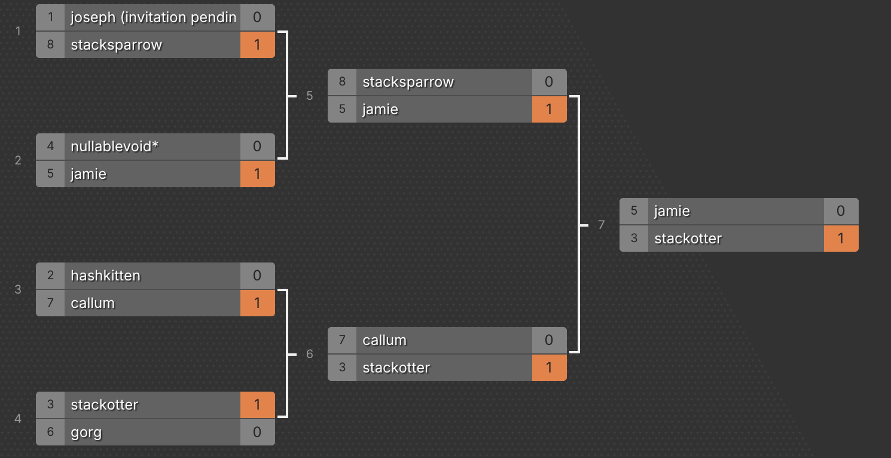

# BSides Canberra 2026 Speedrun CTF

Public release for the BSides Canberra 2026 Speedrun CTF.

## Qualifiers Scores

| Player            | sowingseeds | cmp (both) |
| ----------------- | ----------- | ---------- |
| joseph            | 0:05:15     | 0:10:15    |
| hashkitten        | 0:09:18     | 0:13:47    |
| stackotter        | 0:05:06     | 0:14:36    |
| nullablevoid\*    | 0:08:20     |            |
| jamie             | 0:08:29     |            |
| gorg              | 0:11:28     |            |
| rdjgr             | 0:11:47     |            |
| callum            | 0:12:59     |            |
| stacksparrow      | 0:13:36     |            |
| thesavagetheodore | 0:14:00     |            |
| expr              | 0:14:41     |            |

## Finals Scoreboard

## Challenge List

### Qualifiers

- [cmp](cmp/) — toasterpwn
- [format](format/) — toasterpwn

### Finals

- [bubblesort](bubblesort/) — HexF
- [kachow](kachow/) — toasterpwn
- [mindtwist](mindtwist/) — ItsIronicIInsist
- [ocelotpride](ocelotpride/) — ItsIronicIInsist
- [siegerhino](siegerhino/) — ItsIronicIInsist
- [spectrum](spectrum/) — HexF

### Tiebreakers

- [jarvarscriptar](jarvarscriptar/) — HexF
- [leet](leet/) — toasterpwn
- [sowingseeds](sowingseeds/) — ItsIronicIInsist

# Thank You

## Playtesters

- [unvariant](https://unvariant.pages.dev/)
- slidybat

## BSides Organisers

- [Kylie](https://twitter.com/kylieengineer) & [Silvio](https://twitter.com/silviocesare)
